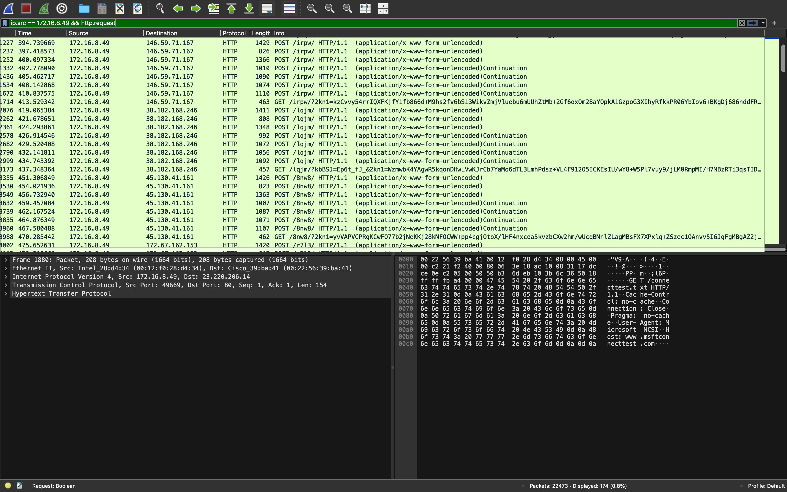
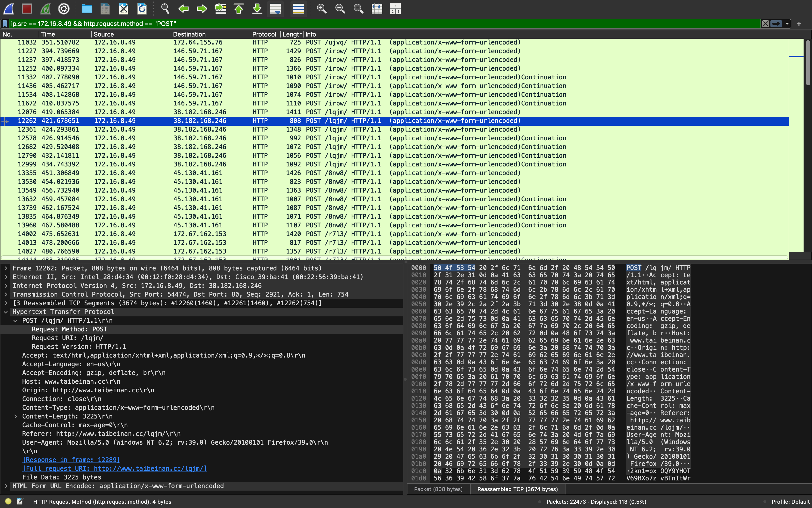
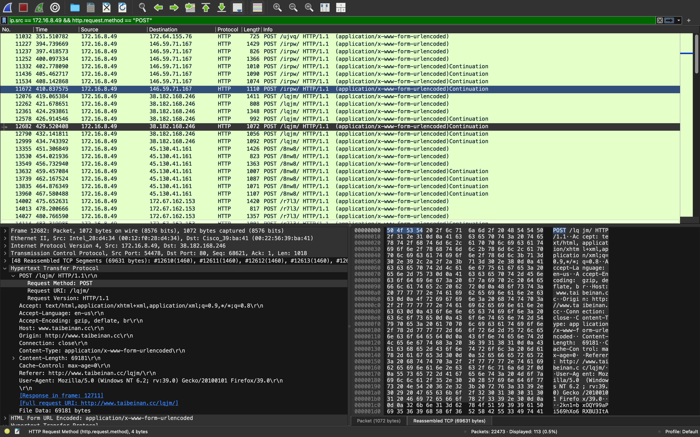

# Case-002 — Suspected FormBook C2 Network Traffic

**Investigation Type:** Network Forensics / HTTP Traffic Analysis
**Environment:** Public malware-traffic training PCAP
**Tools:** Wireshark, TShark, Ubuntu Linux
**Classification:** Suspicious outbound traffic — Escalated
**MITRE ATT&CK:** T1071.001 — Application Layer Protocol: Web Protocols

## Investigation Summary

Investigated FormBook command-and-control alerts using a publicly available network capture dated August 9, 2026.

Identified workstation `172.16.8.49` generating repeated HTTP POST requests to multiple external destinations. The traffic demonstrated short, recurring communication intervals, similar HTTP request structures, and apparently encoded payloads.

## Key Findings

- **Suspected Host:** `172.16.8.49`
- **Suspicious Destinations:** `146.59.71.167`, `38.182.168.246`, `45.130.41.161`
- **Protocol:** HTTP
- **Behavior:** Repeated POST requests with similar request structures
- **Assessment:** Consistent with suspected automated C2 communications
- **Limitation:** Data exfiltration and endpoint malware execution were not independently confirmed

## Evidence

## Disposition

**Escalate to Tier 2 / Incident Response.**

Recommend authorized endpoint isolation, network restrictions for identified suspicious destinations, preservation of evidence, and further endpoint investigation.

## Skills Demonstrated

Wireshark filtering · HTTP request analysis · Network IOC identification · C2 behavior assessment · Evidence correlation · Incident escalation

[Read the full investigation report](report.md)

**Training Source:** Malware-Traffic-Analysis.net — August 9, 2026, *First to Last* exercise.
