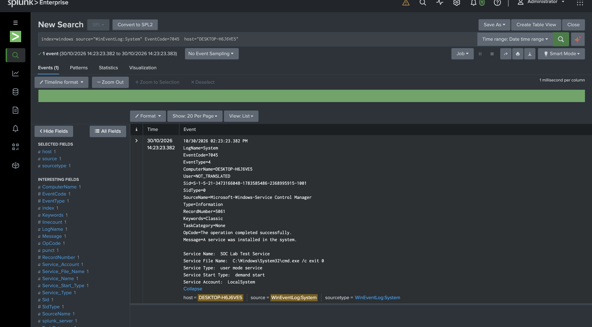
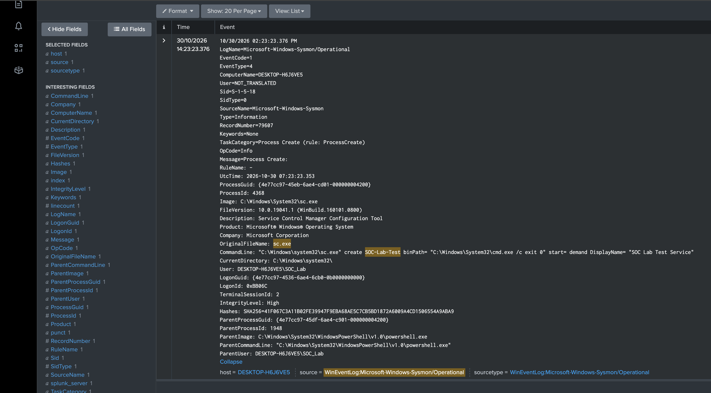
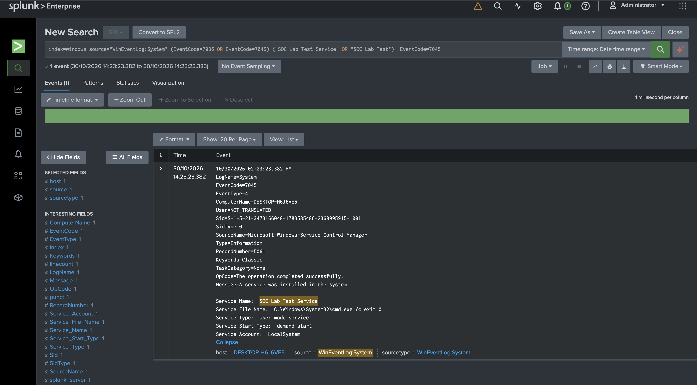

# Case-009 — Suspicious Windows Service Creation

**Investigation Type:** Windows Service / Persistence Analysis
**Environment:** Windows 10 SOC Lab
**Tools:** Splunk, Sysmon, PowerShell
**Classification:** Benign True Positive — Authorized Simulation
**MITRE ATT&CK:** T1543.003 — Create or Modify System Process: Windows Service

## Investigation Summary

Investigated a Windows service-installation event using Splunk and Sysmon telemetry.

Correlated Windows Event ID 7045 with Sysmon Event ID 1, identifying PowerShell launching `sc.exe` to create a service configured to run as LocalSystem.

## Key Findings

- **Host:** `DESKTOP-H6J6VE5`
- **Service:** `SOC Lab Test Service`
- **Executable:** `C:\Windows\System32\cmd.exe /c exit 0`
- **Creating Process:** `sc.exe`
- **Parent Process:** `powershell.exe`
- **Executing User:** `DESKTOP-H6J6VE5\SOC_Lab`
- **Service Account:** `LocalSystem`
- **Startup Type:** Manual
- **Execution:** No service execution confirmed in reviewed telemetry

## Evidence

## Disposition

**Benign True Positive — Authorized Lab Activity.**

Service installation was confirmed, but the activity was an authorized simulation. No malicious execution or persistence was established.

## Skills Demonstrated

Splunk investigation · Windows Event Logs · Sysmon correlation · Process ancestry · Service persistence analysis · Alert classification

[Read the full investigation report](analyst_report.md)
